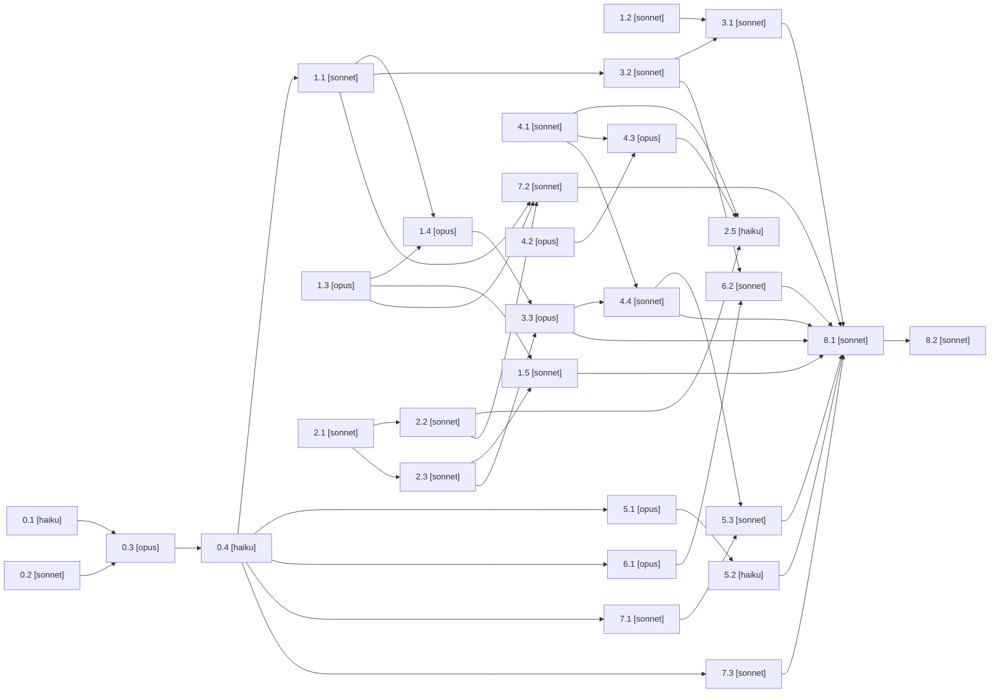

# Plan: Launch Pivot (Expo 9 Nov)

> Pharao output — generated 2026-10-19. Narrative + decisions: `docs/hearth-launch-pivot-plan-v1.md`. State: `.claude/plans/status-launch-pivot.json` (run every pharao.py call with `PHARAO_STATUS=.claude/plans/status-launch-pivot.json`).

## Overview
Ship the launch pivot on an integration branch (`claude/hearth-launch-pivot-v1-175462`): logger Notice→Confirm rebuild as base, Photo Read inside enrichment (flag-gated, OFF in prod until ZDR), Sanity Shelf, confirmed DLO 'watch for next' notes, annotated samples in the Report, account deletion fix, expo scope cuts and demo family. Ends in one PR to main for Drew.

## Tasks

#### Task 0.1: Commit the uncommitted logger rebuild `[HAIKU]` (micro)
- **Files**: `branch:claude/hearth-logger-rebuild-0b8907`
- **Done when**: `git -C <that worktree> status --short` is empty and `git ls-remote origin claude/hearth-logger-rebuild-0b8907` returns a sha equal to its HEAD

#### Task 0.2: Merge PRs #285, #286, #288, #287 to main `[SONNET]` (standard)
- **Files**: `branch:main`
- **Done when**: `gh pr view 285 --json state -q .state` (and 286, 288, 287) all print MERGED, and `gh run list --branch main --limit 1` shows success or in_progress

#### Task 0.3: Rebase logger rebuild onto main, land on integration `[OPUS]` (standard)
- **Files**: `src/app/(auth)/log/page.tsx`, `src/app/(auth)/log/_components/`, `src/components/logger/`, `src/lib/logger/`, `src/hooks/use-notice-form.ts`, `src/hooks/use-notice-save.ts`, `src/lib/ai/enrich.ts`, `src/lib/ai/dlo-persistence.ts`, `src/components/nav/navConfig.ts`, `docs/hearth-decisions-log-v1.md`, `docs/PROJECT_STATUS.md`
- **Done when**: On origin/claude/hearth-launch-pivot-v1-175462: `npx tsc --noEmit`, `npm run lint`, `npm test` all pass, `npm run test:integration:local` passes (or only the known TZ flake: run with TZ=UTC), and docs/hearth-logger-spec-v2.md exists
- **Gate**: blocked on 0.1, 0.2

#### Task 0.4: Log pivot decisions + status `[HAIKU]` (micro)
- **Files**: `docs/hearth-decisions-log-v1.md`, `docs/PROJECT_STATUS.md`
- **Done when**: `grep -c 'D-LP-' docs/hearth-decisions-log-v1.md` >= 10 on the integration branch
- **Gate**: blocked on 0.3

#### Task 1.1: Migration: read + working-from + opt-in columns `[SONNET]` (standard)
- **Files**: `src/lib/db/schema.ts`, `drizzle/`, `src/test/factories.ts`
- **Done when**: tsc passes; `npm run test:integration:local` passes against the migrated container; migration file adds exactly these 4 columns
- **Gate**: blocked on 0.4

#### Task 1.2: Client photo prep: downscale, strip GPS, keep date `[SONNET]` (standard)
- **Files**: `src/lib/images/capture-prep.ts`, `src/lib/images/capture-prep.test.ts`
- **Done when**: `npm test src/lib/images/capture-prep.test.ts` passes; tsc passes

#### Task 1.3: Read prompt + validated output schema `[OPUS]` (standard)
- **Files**: `src/lib/ai/read.prompt.md`, `src/lib/ai/read-schema.ts`, `src/lib/ai/read-schema.test.ts`
- **Done when**: `npm test src/lib/ai/read-schema.test.ts` passes; tsc passes

#### Task 1.4: Photo Read inside enrichEntry (flag-gated) `[OPUS]` (standard)
- **Files**: `src/lib/ai/enrich.ts`, `src/lib/ai/read-flags.ts`, `src/lib/ai/read-flags.test.ts`, `src/lib/ai/__tests__/enrich-read.integration.test.ts`
- **Done when**: unit + integration tests named pass; tsc + lint pass; with PHOTO_READ_ENABLED unset the enrich prompt/request is byte-identical to before (asserted in a test)
- **Gate**: blocked on 1.1, 1.3

#### Task 1.5: Photo fixture harness `[SONNET]` (standard)
- **Files**: `fixtures/photos/`, `src/lib/ai/__tests__/read-fixtures.test.ts`
- **Done when**: `npm test src/lib/ai/__tests__/read-fixtures.test.ts` passes with 10 cases
- **Gate**: blocked on 1.3, 2.3

#### Task 2.1: Sanity shelfResource schema (local only) `[SONNET]` (standard)
- **Files**: `src/sanity/schemas/shelfResource.ts`, `src/sanity/schemas/index.ts`, `src/lib/shelf/types.ts`
- **Done when**: tsc passes; schema exported from index.ts

#### Task 2.2: Shelf wave-1 seed script (not run) `[SONNET]` (standard)
- **Files**: `scripts/seed-shelf.ts`, `package.json`
- **Done when**: `npx tsx scripts/seed-shelf.ts` (dry run) prints 6 docs and exits 0
- **Gate**: blocked on 2.1

#### Task 2.3: Deterministic Shelf matcher `[SONNET]` (standard)
- **Files**: `src/lib/shelf/match.ts`, `src/lib/shelf/match.test.ts`, `src/lib/shelf/query.ts`
- **Done when**: `npm test src/lib/shelf/match.test.ts` passes; tsc passes
- **Gate**: blocked on 2.1

#### Task 2.5: Sanity ops: deploy schema, seed shelf, push note drafts `[HAIKU]` (micro)
- **Files**: `ops:sanity-prod`
- **Done when**: Sanity query count(*[_type=='shelfResource' && !(_id in path('drafts.**'))]) == 6 and draft DLO notes visible in Studio
- **Gate**: blocked on 2.2, 4.1, 4.3

#### Task 3.2: Photo Read disclosure sheet + opt-in API `[SONNET]` (standard)
- **Files**: `src/components/logger/PhotoReadDisclosure.tsx`, `src/components/logger/photoReadCopy.ts`, `src/app/api/family/photo-read/`, `src/app/(auth)/settings/`
- **Done when**: route integration test + component test pass; tsc + lint pass
- **Gate**: blocked on 1.1

#### Task 3.1: Photo-first capture on /log `[SONNET]` (standard)
- **Files**: `src/app/(auth)/log/_components/EvidenceRow.tsx`, `src/app/(auth)/log/_components/NoticeForm.tsx`, `src/app/(auth)/log/_components/noticeCopy.ts`, `src/app/(auth)/log/_components/EvidenceRow.test.tsx`
- **Done when**: log component tests pass; tsc + lint pass
- **Gate**: blocked on 1.2, 3.2

#### Task 3.3: Confirm: Read draft row + Working-from chip `[OPUS]` (standard)
- **Files**: `src/components/logger/confirm/`, `src/hooks/use-notice-save.ts`, `src/lib/logger/confirm-state.ts`, `src/app/api/entries/[id]/read-draft/`
- **Done when**: confirm component tests + new route integration test pass; tsc + lint pass
- **Gate**: blocked on 1.4, 2.3

#### Task 4.1: DLO schema: watchForNext + confirmation fields `[SONNET]` (micro)
- **Files**: `src/sanity/schemas/discreteLearningObjective.ts`
- **Done when**: tsc passes; fields present in schema

#### Task 4.2: Rank and pick ~50 F-Y3 DLOs for notes `[OPUS]` (standard)
- **Files**: `docs/hearth-dlo-notes-targets-v1.md`
- **Done when**: doc exists with >=45 DLO ids that all appear in docs/hearth-capability-dlo-reference.md

#### Task 4.3: Draft DLO 'watch for next' notes + push script `[OPUS]` (standard)
- **Files**: `content/dlo-notes/`, `scripts/push-dlo-note-drafts.ts`
- **Done when**: 5 batch files with notes for every target DLO; `npx tsx scripts/push-dlo-note-drafts.ts` dry run exits 0
- **Gate**: blocked on 4.1, 4.2

#### Task 4.4: Render confirmed 'watch for next' lines `[SONNET]` (standard)
- **Files**: `src/lib/notes/watch-for.ts`, `src/lib/notes/watch-for.test.ts`, `src/components/logger/confirm/WatchForNext.tsx`, `src/components/logger/confirm/ConfirmSurface.tsx`
- **Done when**: tests pass; tsc + lint pass
- **Gate**: blocked on 4.1, 3.3

#### Task 5.1: Annotated work samples in Report + PDF `[OPUS]` (standard)
- **Files**: `src/lib/report/annotated-samples.ts`, `src/lib/report/annotated-samples.test.ts`, `src/app/(auth)/our-story/`, `src/lib/pdf/`
- **Done when**: unit tests pass; existing report tests pass; tsc + lint pass
- **Gate**: blocked on 0.4

#### Task 5.2: Constellation copy: what's growing `[HAIKU]` (micro)
- **Files**: `src/app/(auth)/our-story/capabilities/_constellation/`
- **Done when**: constellation tests pass; tsc passes
- **Gate**: blocked on 5.1

#### Task 5.3: Dashboard: recent moments, chips to confirm, one watch-for `[SONNET]` (standard)
- **Files**: `src/app/(auth)/dashboard/`
- **Done when**: dashboard tests pass; tsc + lint pass
- **Gate**: blocked on 4.4, 7.1

#### Task 6.1: Fix account deletion: D1 = transfer ownership `[OPUS]` (standard)
- **Files**: `src/lib/account/`, `src/app/api/account/delete/`, `docs/hearth-account-deletion-defect-v1.md`
- **Done when**: `npm run test:integration:local` passes including orphan-tables and new transfer tests; tsc + lint pass
- **Gate**: blocked on 0.4

#### Task 6.2: Deletion UI: transfer step `[SONNET]` (standard)
- **Files**: `src/components/settings/AccountDelete.tsx`
- **Done when**: component tests pass; tsc + lint pass
- **Gate**: blocked on 6.1, 3.2

#### Task 7.1: LAUNCH_SCOPE=expo hides cut surfaces `[SONNET]` (standard)
- **Files**: `src/lib/launch-scope.ts`, `src/components/nav/navConfig.ts`, `src/app/(auth)/build/`, `src/app/(auth)/planner/`, `src/app/(auth)/badges/`
- **Done when**: nav tests pass; tsc + lint pass
- **Gate**: blocked on 0.4

#### Task 7.2: Demo family seed + reset with 6 photo moments `[SONNET]` (standard)
- **Files**: `scripts/seed-demo-family.ts`, `fixtures/demo/`, `package.json`
- **Done when**: script runs against the local docker test DB (document the command) and exits 0
- **Gate**: blocked on 1.1, 1.3, 2.2

#### Task 7.3: /expo landing page `[SONNET]` (standard)
- **Files**: `src/app/(public)/expo/`
- **Done when**: page test renders banner; tsc + lint pass
- **Gate**: blocked on 0.4

#### Task 8.1: Docs propagation + registry `[SONNET]` (standard)
- **Files**: `docs/COMPONENT_REGISTRY.md`, `docs/hearth-reporting-pipeline-v1.md`, `docs/external-services-guide.md`, `docs/deployment-runbook.md`, `CLAUDE.md`
- **Done when**: each named doc mentions its new surface (grep)
- **Gate**: blocked on 3.1, 3.3, 4.4, 5.2, 5.3, 6.2, 7.2, 7.3, 1.5

#### Task 8.2: Go/no-go checklist + integration PR `[SONNET]` (standard)
- **Files**: `docs/hearth-expo-go-no-go-v1.md`
- **Done when**: PR exists (`gh pr list --head claude/hearth-launch-pivot-v1-175462`) and all four suites pass
- **Gate**: blocked on 8.1

## Human gates
- **2.5** Sanity prod ops (schema deploy, shelf seed publish, note drafts push) — waits on Drew (decision queue).
- Final PR to main — opened by 8.2, merged only by Drew.

## Dependency Graph


```

## Status

| Task | Status |
|---|---|
| 0.1 | ⬜ |
| 0.2 | ⬜ |
| 0.3 | ⬜ |
| 0.4 | ⬜ |
| 1.1 | ⬜ |
| 1.2 | ⬜ |
| 1.3 | ⬜ |
| 1.4 | ⬜ |
| 1.5 | ⬜ |
| 2.1 | ⬜ |
| 2.2 | ⬜ |
| 2.3 | ⬜ |
| 2.5 | ⬜ |
| 3.2 | ⬜ |
| 3.1 | ⬜ |
| 3.3 | ⬜ |
| 4.1 | ⬜ |
| 4.2 | ⬜ |
| 4.3 | ⬜ |
| 4.4 | ⬜ |
| 5.1 | ⬜ |
| 5.2 | ⬜ |
| 5.3 | ⬜ |
| 6.1 | ⬜ |
| 6.2 | ⬜ |
| 7.1 | ⬜ |
| 7.2 | ⬜ |
| 7.3 | ⬜ |
| 8.1 | ⬜ |
| 8.2 | ⬜ |
