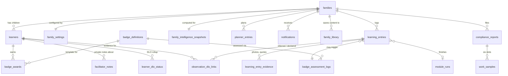
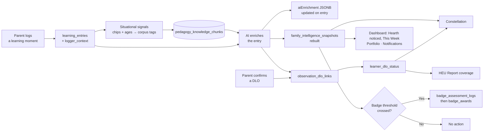

<!-- Version: 2 | Date: 2026-10-20 | Changes: Charts redrawn against build 2026-10-19 (main 82e3c51): outcome-evidence tables, logger_context, PKB retrieval, insights feed. | Version: 1 | Date: 2026-03-09 | Changes: Initial creation — database schema overview for stakeholder communication -->

# Hearth LMS — Data Architecture Overview

## Where data lives

Hearth splits data between two systems. **Sanity CMS** stores reusable educational content that any family can access. **PostgreSQL** (hosted on Neon) stores everything specific to a family — their children, their logged learning, their progress.

The AI layer sits between them: it reads what a parent writes, enriches it with structured educational data, and stores the result in a pre-computed snapshot that every screen reads from.

## The tables, in plain language

| Table | What it holds | Who writes to it |
|-------|--------------|-----------------|
| **families** | Family account — linked to login | System on sign-up |
| **learners** | Each child — name, age, colour code | Parent in Settings |
| **family_settings** | Pedagogy choice, HEU dates, notification prefs | Parent in Settings |
| **learning_entries** | Every logged learning moment — the core of Hearth. Each entry's `aiEnrichment` JSONB contains capability thread mappings, curriculum descriptors, and per-child signals; `logger_context` keeps what the parent tapped (activity, observation chips, where, how long) | Parent via Logger or Module log |
| **badge_definitions** | What a badge means and what's required to earn it. Dual storage: Sanity for platform badges, Postgres for family-created badges (`familyId` NULL = platform) | Content team + Parent via Badge Creator |
| **badge_awards** | Record of a badge earned by a specific child | Parent via Badge Assessment |
| **badge_assessment_logs** | Responses to assessment questions during badge check | Parent via Badge Assessment |
| **planner_entries** | Planned activities for a given day | Parent via Weekly Planner |
| **family_intelligence_snapshots** | Pre-computed summary of everything the AI knows about this family — per child: active threads with first-evidence date and trajectory, the "Hearth noticed" feed (`recent_insights`), `weekStats`, and a monthly narrative reused until its inputs change | System — rebuilt automatically after each log |
| **observation_dlo_links** | Links from a moment to a discrete learning objective, with provenance: inferred by the AI, declared by content, or asserted by the parent (an assertion has no entry) | System at enrichment; Parent via Constellation confirm |
| **learner_dlo_status** | Each child's status per objective — emerging, developing or demonstrating; no row means not started. Rolled up from observed evidence only. What the Constellation and the report read | System — recomputed from the links |
| **pedagogy_knowledge_chunks** | Embedded passages of reviewed pedagogy corpus entries (raw-SQL pgvector table, not in `schema.ts`) | System — Sanity webhook / reembed script, reviewed entries only |
| **notifications** | Nudges, reminders, and invitations | System — generated from snapshot |
| **facilitator_notes** | Private parent-only notes about a child's learning needs | Parent — encrypted, excluded from all exports and AI |
| **family_library** | Which Sanity content packs a family has added | Parent via Activity Discovery |

## How a single log entry flows through the system

> **Note:** Thread-level capability observations are **not** a separate table. They are computed during snapshot rebuild by aggregating `aiEnrichment.capability_threads` across all entries per learner. Thread tiers (emerging/developing/demonstrating) are calculated from observation counts, with optional parent overrides stored in `learners.profileData.tierOverrides`. Objective-level (DLO) evidence *is* stored: `observation_dlo_links` per piece of evidence, rolled up into `learner_dlo_status`.

## What lives in Sanity CMS vs PostgreSQL

| Sanity CMS | PostgreSQL |
|-----------|-----------|
| Content packs, modules, activities | Which packs a family has saved |
| Badge templates and criteria | Which badges a child has earned |
| Capability thread definitions | A child's observations against those threads |
| Discrete learning objectives | A child's DLO links and status (`observation_dlo_links`, `learner_dlo_status`) |
| Pedagogy knowledge base entries | Their embeddings for retrieval (`pedagogy_knowledge_chunks`) |
| Pedagogy overlay templates | Which pedagogy a family chose |
| Curriculum descriptors | A child's coverage against those descriptors |

The rule is simple: if it's **reusable content**, it's in Sanity. If it's **specific to a family**, it's in PostgreSQL.
